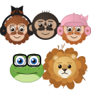
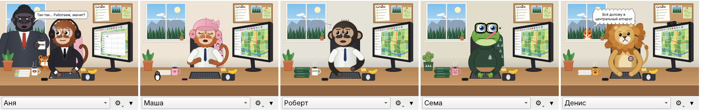

<p align="center">
  
</p>

<h1 align="center">Q-pets</h1>

<p align="center">
  <b>Питомец, который работает вместе с вами в QGIS:</b><br>
  обезьянки, лягушонок и плюшевый лев печатают, когда печатаете вы,<br>
  ждут, пока QGIS считает, и отдыхают, когда отдыхаете вы
</p>

<p align="center">
  <a href="https://github.com/dzhavrshyan-geo/Q-pets/actions/workflows/tests.yml"></a>
  
  
  
</p>

<p align="center">
  <b><a href="release/q_pets-0.4.0.zip">Скачать плагин</a></b> ·
  <a href="docs/ИНСТРУКЦИЯ.md">Инструкция</a> ·
  <a href="docs/ИНСТРУКЦИЯ.pdf">Инструкция (PDF)</a> ·
  <a href="docs/presentation/Q-pets_0.4.pdf">Презентация (PDF)</a> ·
  <a href="CHANGELOG.md">Что нового</a>
</p>

---

<p align="center">
  
</p>

## Что умеет

| | |
|---|---|
| **Повторяет за вами** | Вы печатаете — он стучит по клавиатуре; водите мышкой — карта на его мониторе двигается; Ctrl+S — большой палец, Ctrl+Z — «ой!»; QGIS долго считает — барабанит пальцами и вздыхает. |
| **Отдыхает** | Через 15 секунд простоя — свои дела: кофе, банан, телефон, селфи, окно; иногда выходит из кабинета, после 3 минут дремлет. |
| **Пять питомцев** | Обезьянки Аня, Маша и Роберт, лягушонок Сема и плюшевый лев Денис — у каждого свои любимые дела. |
| **Гости** | Начальник-горилла с кружкой BOSS проверяет, кто работает; лиса шпионит из-за ёлок за окном. |
| **Викторина** | Раз в 5 минут — вопрос по Лесоустроительной инструкции с четырьмя вариантами; 100 вопросов, после ответа — пункт инструкции. |

<table>
  <tr>
    <td width="33%"><br><sub>Начальник: «Так-так… Работаем, значит?»</sub></td>
    <td width="33%"><br><sub>Лиса за окном: «Ничего, я терпеливая…»</sub></td>
    <td width="33%"><br><sub>Вопрос викторины</sub></td>
  </tr>
</table>

## Установка

1. Скачайте [**q_pets-0.4.0.zip**](release/q_pets-0.4.0.zip) (кнопка «Download raw file»).
2. В QGIS: **Модули → Управление и установка модулей → Установить из ZIP** → выберите файл.
3. Окошко появится в правом нижнем углу QGIS. Вернуть закрытое — кнопкой с обезьянкой на
   панели модулей или **Модули → Q-pets**.

Работает в QGIS 3.16 и новее (в том числе QGIS 4 на Qt6), Windows / Linux / macOS.

## Документация

- [**Инструкция**](docs/ИНСТРУКЦИЯ.md) — окошко, поведение, питомцы, гости, викторина;
  [то же в PDF](docs/ИНСТРУКЦИЯ.pdf).
- [**Презентация**](docs/presentation/Q-pets_0.4.pdf) (PDF).
- [**История изменений**](CHANGELOG.md).

## Для разработчика

Нужен Python с PyQt5 (`pip install PyQt5`), QGIS для этого не нужен:

```bash
python -m unittest discover -s tests   # тесты (поведение, рисование, плагин с заглушкой QGIS)
python tools/preview.py out            # кадры всех анимаций: out/sheet_*.png
python tools/make_icon.py              # перерисовать q_pets/icon.png
python tools/make_doc_images.py        # картинки для документации: docs/img
python tools/build_zip.py              # dist/q_pets.zip для установки
python tools/build_docs.py             # docs/ИНСТРУКЦИЯ.pdf (нужны markdown, Node.js, Playwright)
node tools/build_presentation.js       # PDF презентации из docs/presentation/source
```

| Файл | Что внутри |
|---|---|
| `q_pets/plugin.py` | панель в QGIS, отслеживание клавиатуры/мыши и занятости QGIS |
| `q_pets/pet_widget.py` | окошко: сцена (или вопрос викторины) и нижняя панель с настройками |
| `q_pets/brain.py` | поведение: когда работать, когда ждать, когда отдыхать, когда выйти из кабинета |
| `q_pets/visitors.py` | начальник и лиса: когда приходят и что говорят |
| `q_pets/quiz.py`, `quiz_widget.py`, `quiz_questions.py` | викторина: выбор вопросов, окно, сами вопросы |
| `q_pets/animation.py` | анимации: позы по времени и плавные переходы между ними |
| `q_pets/drawing.py` | рисование кабинета, тел, рук и вещей (всё векторное, без картинок) |
| `q_pets/heads.py` | головы: обезьянки, шимпанзе, лягушонок, плюшевый лев |
| `q_pets/visitors_draw.py` | рисование начальника, лисы и облачков с репликами |
| `q_pets/pets.py` | описание питомцев: цвета, одежда, вещи на столе, любимое дело |

Чтобы добавить питомца, допишите его в `pets.py`; его любимые дела (`specials`) — анимации из
`animation.py` (словарь `ACTIVITIES`).

Тесты идут на каждый push в GitHub Actions (Ubuntu 24.04, PyQt5, без окна).

## Авторы и лицензия

Джавршян Роберт и Claude (Anthropic).

Свободное программное обеспечение: [GNU General Public License версии 2](LICENSE) или более
поздней. Предоставляется «как есть», без каких-либо гарантий.
