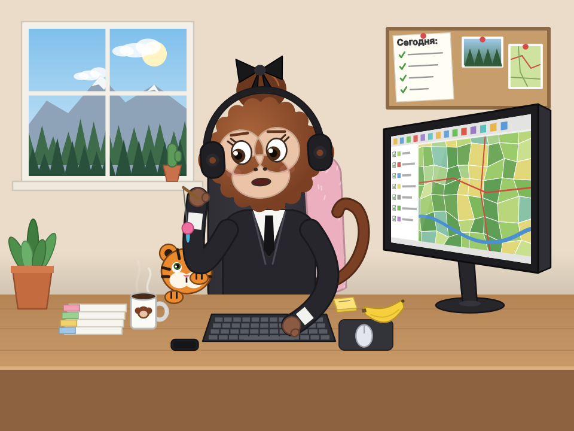
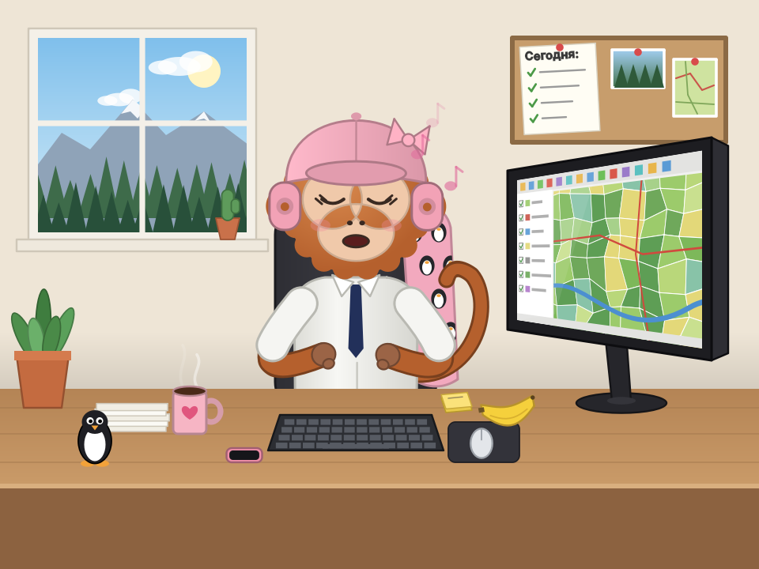
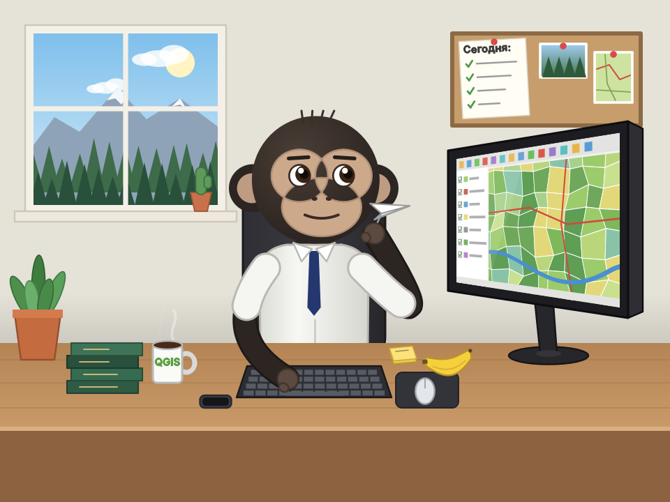
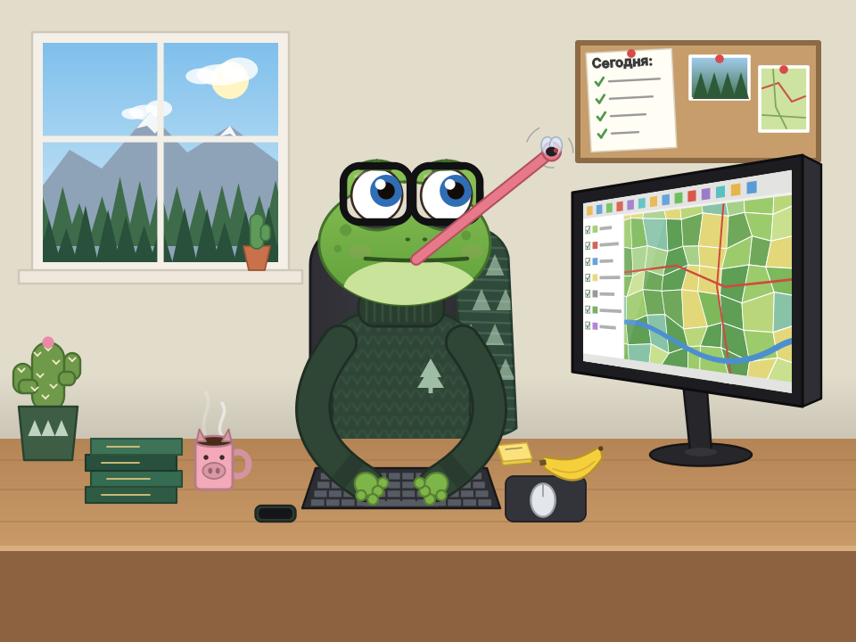
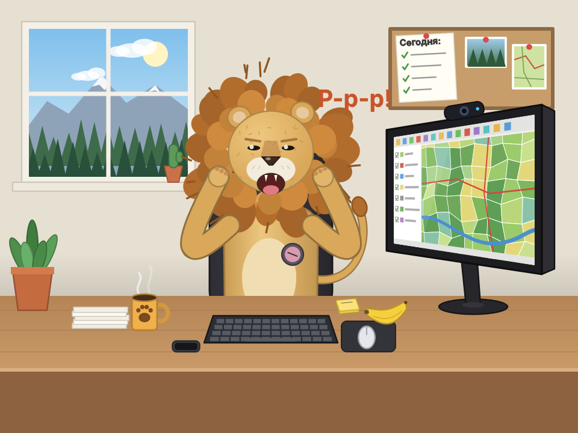
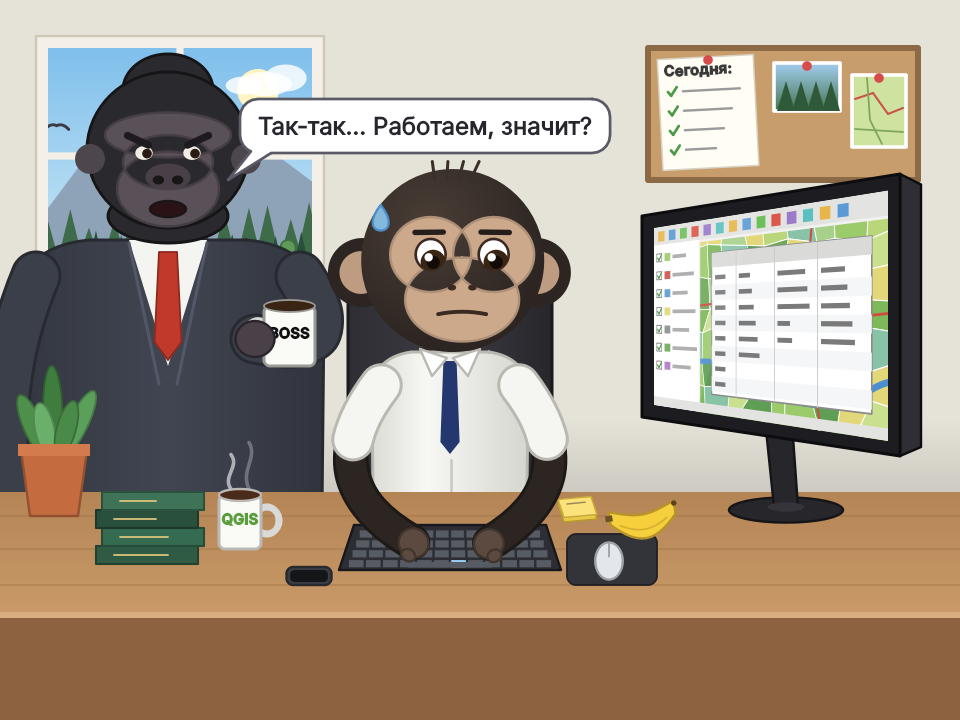
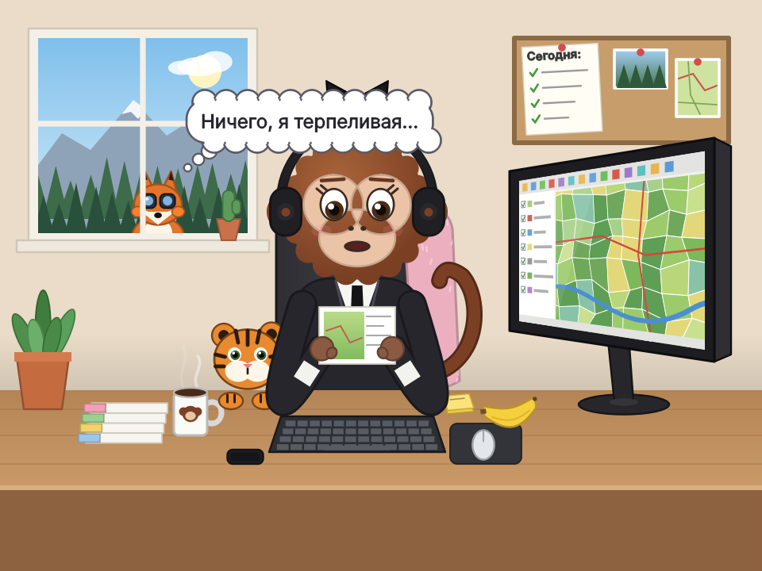
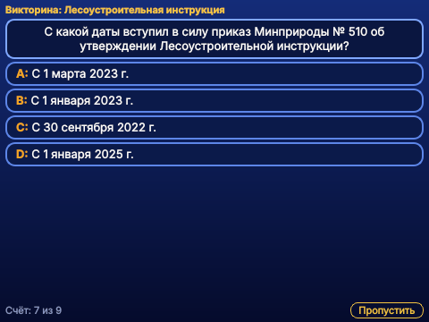

# Q-pets — инструкция

Версия 0.4.0 · Джавршян Роберт и Claude (Anthropic)

Q-pets — небольшое окошко с питомцем, который работает вместе с вами в QGIS: печатает, когда
печатаете вы, водит мышкой, ждёт, пока QGIS считает, отдыхает, когда вы отдыхаете. Иногда к
нему заходит начальник, за окном шпионит лиса, а раз в 5 минут можно ответить на вопрос
викторины по Лесоустроительной инструкции.

## Содержание

1. [Установка](#1-установка)
2. [Окошко](#2-окошко)
3. [Чем занят питомец](#3-чем-занят-питомец)
4. [Питомцы](#4-питомцы)
5. [Гости](#5-гости)
6. [Викторина](#6-викторина)
7. [О плагине](#7-о-плагине)

## 1. Установка

1. Скачать [`release/q_pets-0.4.0.zip`](../release/q_pets-0.4.0.zip). Или скачать репозиторий и положить папку `q_pets` в папку модулей QGIS
   (Windows: `%APPDATA%\QGIS\QGIS3\profiles\default\python\plugins`).
2. QGIS → «Модули» → «Управление и установка модулей» → «Установить из ZIP».
3. При первом запуске окошко появится в правом нижнем углу QGIS.

Работает в QGIS 3.16 и новее (в том числе QGIS 4 на Qt6), Windows / Linux / macOS.

## 2. Окошко

- Это обычная панель QGIS: её можно перетащить в любое место, прикрепить к боковой панели
  или к вкладкам рядом со «Слоями». QGIS запоминает, где она была, и при следующем запуске
  откроет её там же. Окошко всегда поверх QGIS и сворачивается вместе с ним.
- Внизу: выбор питомца, **⚙** — настройки (через сколько секунд простоя отдыхать: 10/15/30/60,
  дремать ли после 3 минут, выходить ли из кабинета, гости, викторина),
  **▾** — свернуть окошко до полоски, **▴** — развернуть.
- Закрыть окошко можно крестиком, вернуть — кнопкой с обезьянкой на панели модулей
  или «Модули → Q-pets». При каждом запуске QGIS питомец открывается сам; чтобы он
  не появлялся совсем, отключите модуль.
- Пока окошко скрыто или свёрнуто, анимация не идёт и ресурсы не тратятся.

## 3. Чем занят питомец

| Когда | Что делает |
|---|---|
| вы печатаете | стучит по клавиатуре (иногда с размаху по Enter), на мониторе заполняется таблица атрибутов |
| работаете мышкой | водит мышкой и щёлкает, карта на его мониторе двигается |
| крутите колёсико | крутит колёсико, карта на мониторе приближается и отдаляется |
| Ctrl+S | показывает большой палец и подмигивает, на мониторе «Сохранено» |
| Ctrl+Z | «ой!» — хлопает себя по лбу |
| QGIS долго рисует карту или считает инструмент | барабанит пальцами, потом ждёт, скрестив руки, и вздыхает «…» |
| ничего не нажимаете (до 15 с) | работает без нажатий: читает экран, подпирает голову, чешет затылок, всматривается в монитор, пишет на стикере, разминает шею, крутит ручку в пальцах, клюёт носом |
| 15 с простоя | свои дела: смотрит в окно, сидит в телефоне, говорит по телефону, пьёт кофе, потягивается, зевает, чихает, ест банан, читает распечатку, делает селфи, отдыхает, закинув руки за голову, отмечает дело в списке на доске, жонглирует шишками, бросает бумажный комок в корзину, качает бицепс, — и два любимых дела |
| иногда, во время отдыха | встаёт и выходит из кабинета на 15–60 с (на нажатие сразу возвращается) |
| 3 мин простоя | дремлет; от первого нажатия просыпается |
| щелчок по питомцу | машет рукой |
| заходит начальник | если питомец отдыхает или спит — подпрыгивает от испуга и изо всех сил печатает, пока начальник ворчит; если работает — начальник даёт задачу, питомец отвечает «Сделаю!»; если питомца нет — начальник смотрит на пустой стул |

Считаются только действия внутри QGIS (в любом его окне), кроме самого окошка питомца.
За окном в кабинете день, вечер или ночь — по часам компьютера.

## 4. Питомцы

| Питомец | Любимые дела |
|---|---|
| Аня — обезьянка с бантиком и тигрёнком | гладит тигрёнка; дразнит его игрушкой на верёвочке. Печатая, от усердия высовывает язык |
| Маша — обезьянка в розовой кепке | подпирает щёку и мечтает под музыку; танцует на стуле |
| Роберт — шимпанзе в галстуке | чешет подбородок, пока не придёт идея; запускает бумажный самолётик через весь кабинет |
| Сема — лягушонок в очках и свитере | ловит муху языком; протирает очки |
| Денис — плюшевый лев | ерошит и распушает гриву; грозно рычит «Р-р-р!» и сам смущается |

Выбранный питомец запоминается и остаётся при следующем запуске QGIS.

| | |
|---|---|
|  *Аня дразнит тигрёнка игрушкой* |  *Маша танцует на стуле* |
|  *Роберт запускает бумажный самолётик* |  *Сема ловит муху языком* |
|  *Денис грозно рычит «Р-р-р!»* | |

## 5. Гости

- **Начальник** — большая горилла в костюме с кружкой BOSS. Заглядывает каждые 7–14 минут.
- **Лиса** — выглядывает из-за ёлок за окном, следит в бинокль и думает что-нибудь вроде
  «Всё доложу в центральный аппарат». Если питомец посмотрит в окно или войдёт начальник —
  прячется.

Обоих можно выключить или позвать прямо сейчас в меню **⚙**.

| | |
|---|---|
|  *Начальник заглянул: «Так-так… Работаем, значит?»* |  *Лиса следит за окном: «Ничего, я терпеливая…»* |

## 6. Викторина

Каждые 5 минут (можно 10, 15 или 30) вместо сцены появляется вопрос по
Лесоустроительной инструкции с четырьмя вариантами — как в «Кто хочет стать
миллионером». Щёлкните по ответу: правильный подсвечивается жёлтым, неверно
выбранный — красным. Питомец радуется правильному ответу или хватается за голову.
Вопросы не повторяются, пока не пройдены все; счёт виден в меню **⚙**.
Викторина включена по умолчанию, выключается там же.

В викторине 100 вопросов по Лесоустроительной инструкции (приказ Минприроды России
от 05.08.2022 № 510) — по всем разделам: зоны освоения лесов, документация, материалы
ДЗЗ, лесничества и кварталы, защитные леса и ОЗУ, закрепление границ, таксация, контроль
качества. После ответа показывается пункт инструкции, на котором основан вопрос.
Вопросы лежат в `q_pets/quiz_questions.py` (формат описан в начале файла).

*Вопрос викторины: правильный ответ подсвечивается жёлтым, неверно выбранный — красным.*

## 7. О плагине

Q-pets, версия 0.4.0. Разработчики: Джавршян Роберт и Claude (Anthropic).

Свободное программное обеспечение: распространяется на условиях GNU General Public License
версии 2 или более поздней. Предоставляется «как есть», без каких-либо гарантий.
